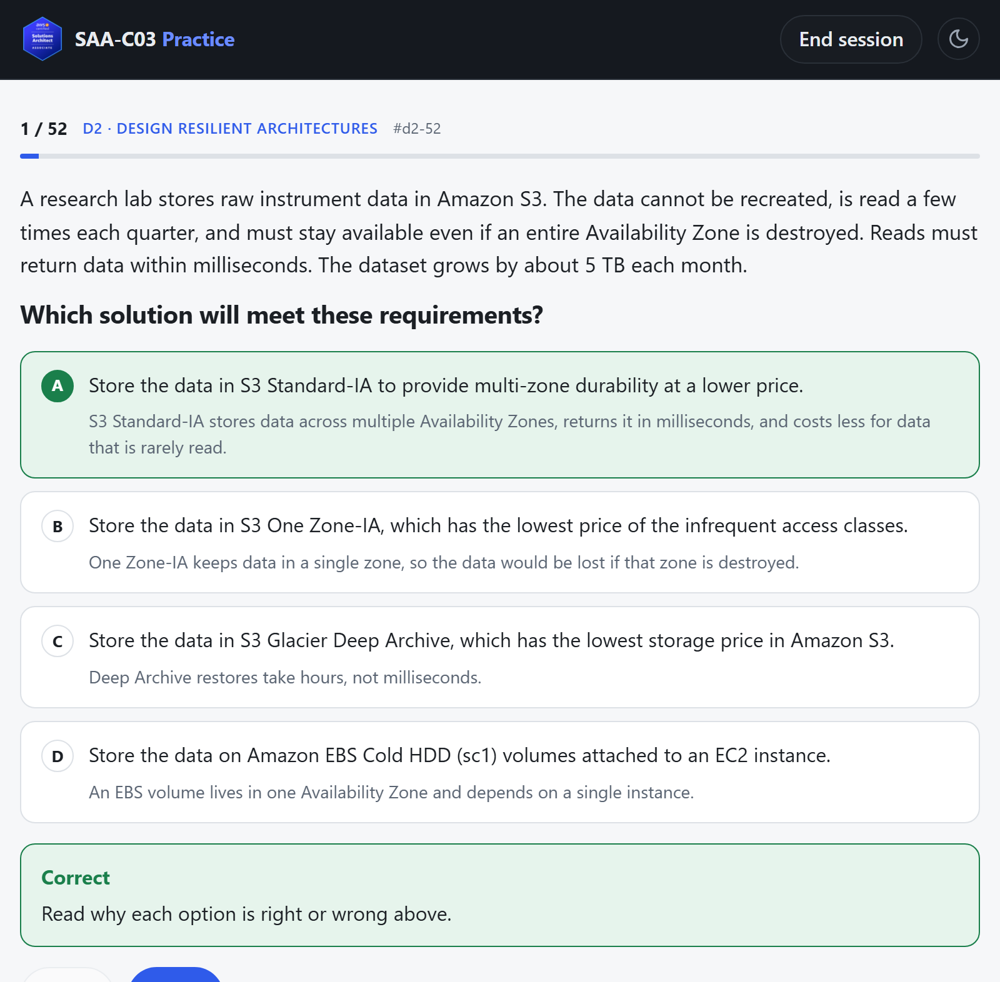
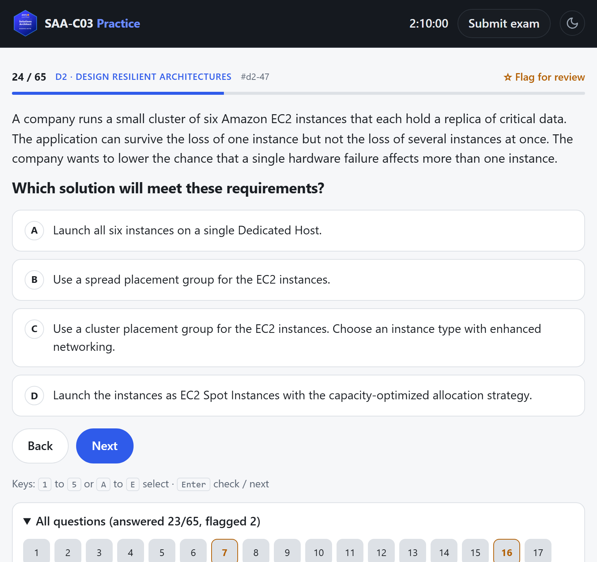
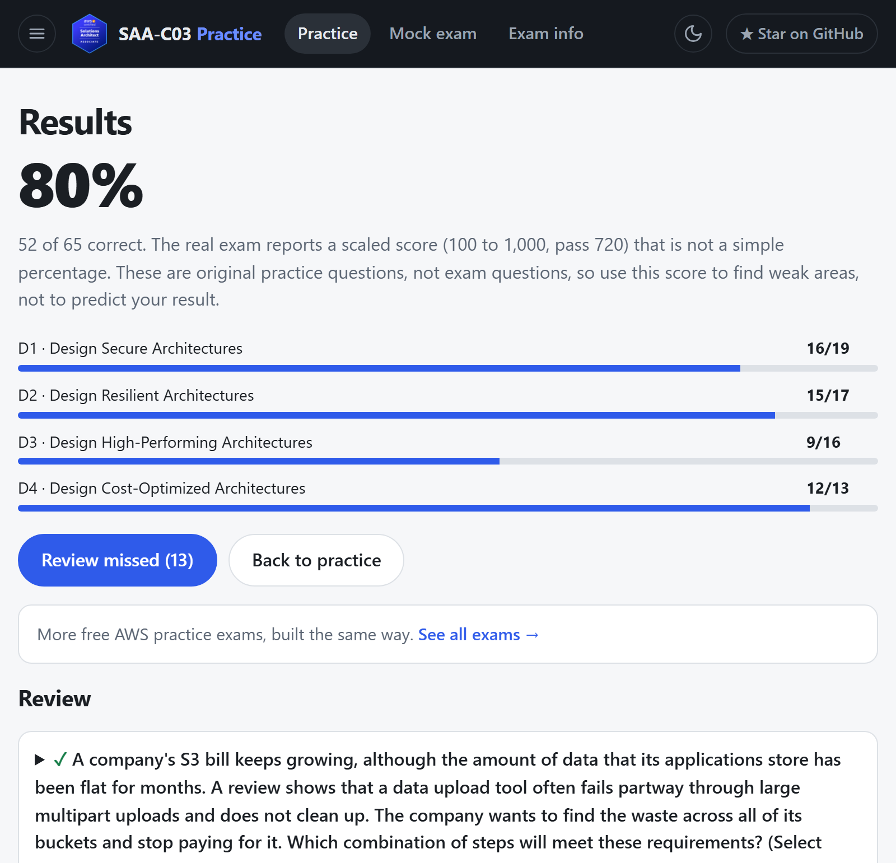

<div align="center">


# SAA-C03 Practice

Free practice questions and a timed mock exam for the **AWS Certified Solutions Architect - Associate (SAA-C03)** exam.<br>
200 original scenario questions across the 4 domains, a rationale for every option, no signup, no ads.

**[Start practicing](https://zghanw.github.io/aws-solutions-architect-associate/)** · [Report a wrong answer](https://github.com/zghanw/aws-solutions-architect-associate/issues/new/choose) · [Contribute a question](CONTRIBUTING.md)

<a href="https://zghanw.github.io/aws-solutions-architect-associate/"></a>
<a href="https://github.com/zghanw/aws-solutions-architect-associate/actions/workflows/check.yml"></a>
<a href="https://github.com/zghanw/aws-solutions-architect-associate/commits/main"></a>
<a href="LICENSE"></a>

<br><br>

<picture>
  <source media="(prefers-color-scheme: dark)" srcset="docs/screenshots/question-dark.png">
  <source media="(prefers-color-scheme: light)" srcset="docs/screenshots/question-light.png">
  
</picture>

</div>

## Why this exists

I value free education. I strongly believe that practice should be free for anyone who learns with their whole heart and is willing to take the time to learn and practice.

Good SAA-C03 practice material usually sits behind a paywall, and dumps of real exam questions teach you nothing (and break the AWS Certification Program Agreement). This site gives you 200 original questions built on the current exam guide, each with an explanation for every option, so you learn why an answer is right and why the others fall short. It's free, and it will stay free.

## What's inside

| Domain | Exam weight | Questions |
|---|---:|---:|
| 1. Design Secure Architectures | 30% | 60 |
| 2. Design Resilient Architectures | 26% | 52 |
| 3. Design High-Performing Architectures | 24% | 48 |
| 4. Design Cost-Optimized Architectures | 20% | 40 |

- Practice one domain at a time. After each answer, every option shows why it's right or wrong.
- Take a mock exam in the real format: 65 questions in 130 minutes, split by the official domain weights.
- Get both multiple-choice and multiple-response questions, like the real exam.
- Practice the trade-offs the exam is built on: least operational overhead, lowest cost, high availability, and security, with the standard AWS design as the right answer.
- Review each result with your answer and the correct answer labeled.
- Come back to the questions you missed. They're saved in your browser.
- Use it on a phone or a laptop, in light or dark mode.

<p align="center">
  <picture>
    <source media="(prefers-color-scheme: dark)" srcset="docs/screenshots/mock-dark.png">
    
  </picture>
  <picture>
    <source media="(prefers-color-scheme: dark)" srcset="docs/screenshots/results-dark.png">
    
  </picture>
</p>

## How the questions are written

Every question is original and written against the public [SAA-C03 exam guide](https://docs.aws.amazon.com/aws-certification/latest/solutions-architect-associate-03/solutions-architect-associate-03.html). None come from the real exam, paid courses, or dumps. Each one has a short architecture scenario, a clear requirement, and options of similar length where every wrong answer is a plausible action that fails one requirement. The right answer is not the longest option, and `check.js` enforces that on every change.

The questions were drafted with AI help, then checked one by one against the exam guide and AWS documentation.

Question bank last reviewed: November 2026, against exam guide version 1.1.

Think a question is wrong? [Open an issue](https://github.com/zghanw/aws-solutions-architect-associate/issues/new/choose) with the question ID shown above each question. You don't need to write any code.

## Official resources

- [SAA-C03 Exam Guide](https://docs.aws.amazon.com/aws-certification/latest/solutions-architect-associate-03/solutions-architect-associate-03.html), including the in-scope and out-of-scope service lists
- [AWS Certified Solutions Architect - Associate](https://aws.amazon.com/certification/certified-solutions-architect-associate/)
- [Exam prep for SAA-C03](https://skillbuilder.aws/category/exam-prep/solutions-architect-associate-SAA-C03) on AWS Skill Builder, including the Official Practice Question Set
- [AWS Well-Architected Framework](https://docs.aws.amazon.com/wellarchitected/latest/framework/framework.html), the basis for the exam's design questions

## Run it locally

It's a static site with no build step and no dependencies.

```sh
git clone https://github.com/zghanw/aws-solutions-architect-associate.git
cd aws-solutions-architect-associate
python -m http.server 8000
```

Then open http://localhost:8000. Run `node check.js` to validate the question bank. CI runs the same check on every push.

## Contributing

Questions live in `data/d1.js` to `data/d4.js`, one file per domain, and exam details such as the domain weights live in `exam.js`. [CONTRIBUTING.md](CONTRIBUTING.md) covers the format and the ground rules. To suggest a question or report a wrong one, use the [issue forms](https://github.com/zghanw/aws-solutions-architect-associate/issues/new/choose).

If this helped you prepare, a star helps other candidates find it.

## More free AWS practice

- [AIB-C01 Practice](https://zghanw.github.io/aws-ai-business-strategist/) for the AWS Certified AI Business Strategist exam: 340 questions and a timed mock exam, built the same way.
- [SOA-C03 Practice](https://zghanw.github.io/aws-cloudops-engineer-associate/) for the AWS Certified CloudOps Engineer - Associate exam: 325 questions and a timed mock exam, built the same way.
- [SCS-C03 Practice](https://zghanw.github.io/aws-security-specialty/) for the AWS Certified Security - Specialty exam: 300 questions and a timed mock exam, built the same way.

## Disclaimer

This is an unofficial study aid, not affiliated with or endorsed by Amazon Web Services. AWS and AWS Certified are trademarks of Amazon.com, Inc. or its affiliates.

## License

[MIT](LICENSE)
